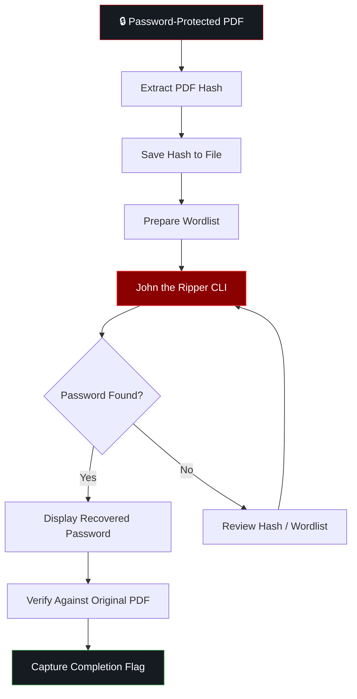
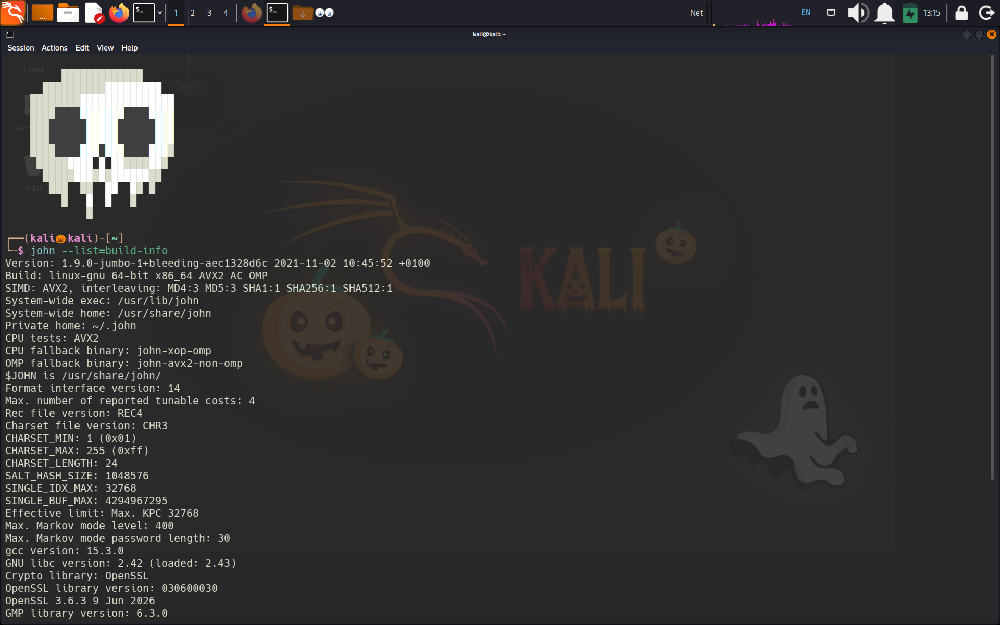
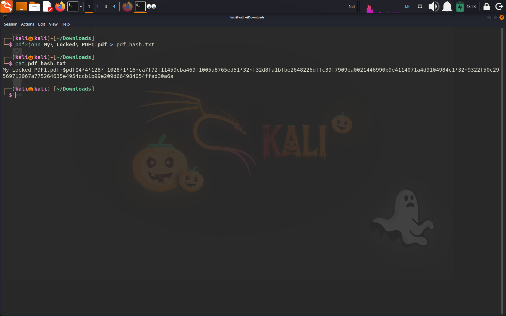
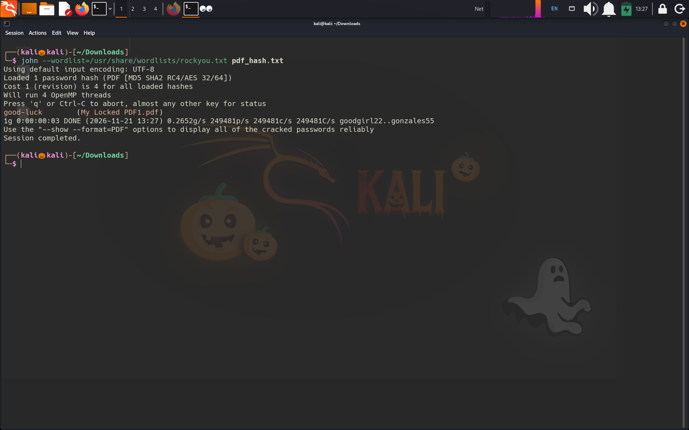
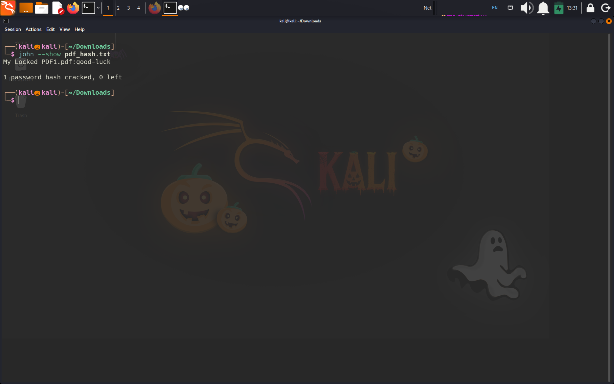
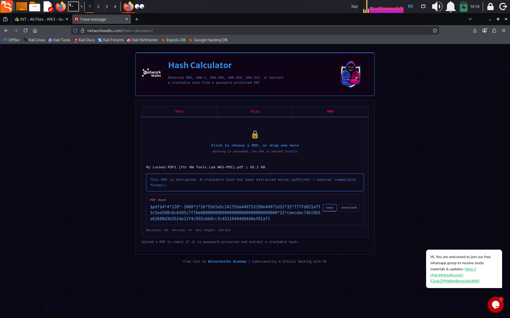
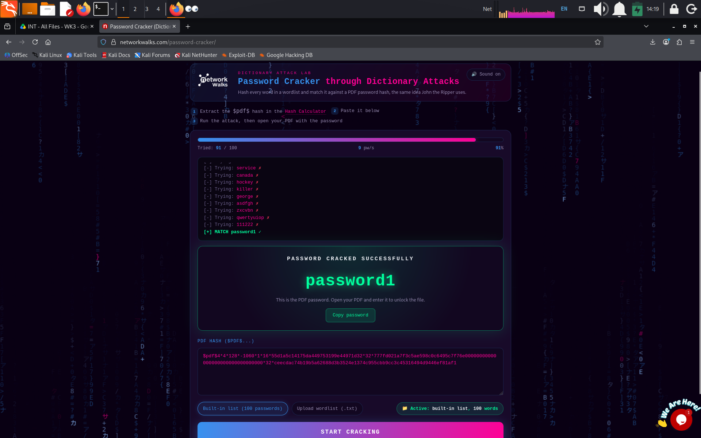

# 🔐 PDF Password Security

### Hash Extraction · Dictionary Attacks · Password Recovery

<p align="center">
  
  
  
</p>

<p align="center">
  <b>Week 03 | Networkwalks Cybersecurity Internship</b><br/>
  <i>Practical exploration of PDF password auditing using CLI tools and hash comparison.</i>
</p>

---

## ⚡ Mission Brief

> [!IMPORTANT]
> This repository documents my Week 03 cybersecurity practicals involving password-protected PDF documents, hash extraction, dictionary-based password auditing, password recovery, and verification.

The practical consisted of two modules:

| Module | Objective | Tools |
|:---:|---|---|
| `01` | Recover a PDF password using a dictionary attack | John the Ripper CLI |
| `02` | Extract and compare PDF password hashes | Networkwalks Hash Calculator & Comparison Tool |

The first module focused on the command-line workflow, while the second demonstrated password hash analysis through the Networkwalks tools.

## 🧭 Navigation

<details open>
<summary><b>📂 Explore this README</b></summary>

- [Mission Brief](#-mission-brief)
- [Lab Environment](#-lab-environment)
- [Attack Workflow](#-attack-workflow)
- [Module 01 — John the Ripper CLI](#-module-01--john-the-ripper-cli)
- [Module 02 — Networkwalks Tools](#-module-02--networkwalks-tools)
- [Results & Flags](#-results--flags)
- [Key Learnings](#-key-learnings)
- [Security Recommendations](#-security-recommendations)
- [Repository Structure](#-repository-structure)
- [Disclaimer](#️-disclaimer)

</details>

---

## 🖥️ Lab Environment

<p align="center">
  
  
  
  
</p>

| Environment | Details |
|---|---|
| Trainee | Ayesha Kazi |
| Organization | Networkwalks |
| Internship | Week 03 |
| Operating System | Kali Linux |
| Primary Tool | John the Ripper CLI |
| Attack Method | Dictionary-based password auditing |
| Target | Authorized password-protected PDF |
| Verification | Original PDF document |

---

## 🗺️ Attack Workflow



<details>
<summary><b>🔎 Workflow breakdown</b></summary>

1. **Hash extraction** — Extract password-verification information from the encrypted PDF.
2. **Hash preparation** — Save the extracted output in a file compatible with John the Ripper.
3. **Dictionary attack** — Test candidate passwords from a wordlist.
4. **Password recovery** — Display any successfully recovered password.
5. **Verification** — Confirm that the recovered password opens the original PDF.
6. **Completion** — Capture the training platform's completion flag.

</details>

---

# 🔴 Module 01 — John the Ripper CLI

<p align="center">
  
</p>

## 01. Check the installation

I checked the John the Ripper build information in my Kali Linux environment.

```bash
john --list=build-info
```

To explore the available options:

```bash
john --help
```

<details>
<summary><b>📸 John the Ripper version</b></summary>



</details>

---

## 02. Locate the PDF hash extraction utility

Before auditing an encrypted PDF, I located the PDF hash extraction utility available in my John the Ripper installation.

```bash
find /usr/share/john -iname '*pdf2john*'
```

The extractor's filename and location may vary depending on the installed version.

---

## 03. Extract the PDF hash

The PDF hash extraction utility was used to process the authorized training document.

The extracted output was saved to `pdf_hash.txt`.

```bash
pdf2john "My Locked PDF1.pdf" > pdf_hash.txt
```

If the extractor is not available as a command, use the path returned by the `find` command and run the appropriate Python or Perl script.

<details>
<summary><b>📸 Extracted PDF hash</b></summary>



</details>

> [!NOTE]
> The extracted hash is not the original password. It contains password-verification information that compatible auditing tools can process.

---

## 04. Prepare the wordlist

A dictionary attack uses a list of candidate passwords.

The wordlist used in this practical was:

```text
/usr/share/wordlists/rockyou.txt
```

If the wordlist is compressed, decompress it while retaining the original archive:

```bash
sudo gzip -dk /usr/share/wordlists/rockyou.txt.gz
```

---

## 05. Execute the dictionary attack

With the extracted hash and wordlist prepared, I used John the Ripper CLI to perform the password audit.

```bash
john --wordlist=/usr/share/wordlists/rockyou.txt pdf_hash.txt
```

John the Ripper tested candidate passwords from the specified wordlist against the extracted PDF hash.

<details>
<summary><b>📸 John the Ripper dictionary attack</b></summary>



</details>

---

## 06. Display the recovered password

After the attack, I used the `--show` option to display the recovered result.

```bash
john --show pdf_hash.txt
```

This command displays passwords successfully recovered for hashes in the specified file.

<details>
<summary><b>📸 Password recovery result</b></summary>



</details>

---

## 07. Verify the password

I entered the recovered password into the password prompt of the original PDF.

Successful access confirmed that the recovered password was valid for the training document.

---

## 08. Capture the flag

After completing the practical, I captured the completion flag displayed by the Networkwalks training platform.

```text
nw{cybersecurity_flag_captured_2608}
```

<details>
<summary><b>🏁 Module 01 completion screenshot</b></summary>


</details>

### Module 01 — Results

| Task | Status |
|---|:---:|
| PDF hash extraction | ✅ |
| Hash file preparation | ✅ |
| Wordlist configuration | ✅ |
| John the Ripper CLI execution | ✅ |
| Password recovery | ✅ |
| PDF verification | ✅ |
| Flag capture | ✅ |

---

# 🟣 Module 02 — Networkwalks Tools

<p align="center">
  
</p>

This module involved extracting a PDF hash through the Networkwalks Hash Calculator and testing password candidates using the Networkwalks Comparison Tool.

## Workflow


<details>
<summary><b>01 — Extract the PDF hash</b></summary>

I opened the Networkwalks Hash Calculator and selected the PDF hash extraction option.

The encrypted training document was processed, and the tool generated a PDF-compatible hash representation.



</details>

<details>
<summary><b>02 — Submit the hash for comparison</b></summary>

I entered the extracted PDF hash into the Networkwalks Comparison Tool and initiated the dictionary-based comparison process.

</details>

<details>
<summary><b>03 — Observe the successful match</b></summary>

The comparison process identified a matching password candidate and displayed a successful completion notification.



</details>

<details>
<summary><b>04 — Verify the recovered password</b></summary>

I used the recovered password to open the corresponding protected PDF.

The document accepted the password and opened successfully.

</details>

<details>
<summary><b>05 — Capture the completion flag</b></summary>

After completing the second practical, I captured the flag displayed by the Networkwalks training platform.

```text
nw{networkwalks_flag1_jtr_270521_1}
```


</details>

---

## 🏆 Results & Flags

| Module | Tool | Outcome |
|---|---|---|
| `01` | John the Ripper CLI | Password successfully recovered |
| `02` | Networkwalks Hash Calculator & Comparison Tool | Password match identified |

<details>
<summary><b>🏁 Click to reveal completion flags</b></summary>

| Module | Flag |
|---|---|
| Module 01 | `nw{cybersecurity_flag_captured_2608}` |
| Module 02 | `nw{networkwalks_flag1_jtr_270521_1}` |

</details>

---

## 🧠 Key Learnings

<details>
<summary><b>01 — PDF Password Security</b></summary>

Understood how password-protected PDF documents use encryption and password-verification information to protect their contents.

</details>

<details>
<summary><b>02 — Hash Extraction</b></summary>

Learned how password-related information can be extracted from an encrypted PDF and converted into a compatible format.

</details>

<details>
<summary><b>03 — John the Ripper CLI</b></summary>

Gained practical experience using terminal commands to process an extracted hash and perform password auditing.

</details>

<details>
<summary><b>04 — Dictionary Attacks</b></summary>

Understood how wordlists are used to test candidate passwords against a password hash.

</details>

<details>
<summary><b>05 — Password Verification</b></summary>

Learned why recovered passwords should be tested against the original document to confirm the result.

</details>

<details>
<summary><b>06 — Responsible Security Testing</b></summary>

Reinforced the importance of conducting password audits only on personal documents, authorized training files, or documents for which explicit permission has been granted.

</details>

---

## 🛡️ Security Recommendations

- Use long, unique, and unpredictable passwords.
- Avoid common words, predictable patterns, and personal information.
- Do not reuse passwords across documents or accounts.
- Use appropriate PDF encryption settings and security-supported software.
- Store document passwords securely.
- Avoid sharing passwords through unprotected communication channels.
- Perform password security assessments only with proper authorization.

---

## 📂 Repository Structure

```text
Week-03-PDF-Password-Security/
│
├── README.md
│
└── screenshots/
    ├── captured-flag-1.png
    ├── captured-flag-2.png
    ├── extracted-pdf-hash.png
    ├── john-dict-attack.png
    ├── john-version.png
    ├── networkwalks-hash-calculation.png
    ├── networkwalks-pass-match.png
    └── pswd-recovered.png
```

---

## 💡 Final Takeaway

This practical connected concepts such as encryption, hashing, password verification, and dictionary attacks with hands-on cybersecurity tools.

Through John the Ripper CLI, I explored the workflow of extracting a PDF hash, preparing a wordlist, executing a dictionary attack, recovering a password, and verifying it against the original document.

The Networkwalks tools module further demonstrated how hash extraction and dictionary comparison can be performed through a separate workflow.

> **Security insight:** Strong encryption is essential, but the strength and unpredictability of the password remain critical to the security of an encrypted document.

---

## ⚠️ Disclaimer

This repository is maintained for educational and documentation purposes as part of the Networkwalks Cybersecurity Internship.

All practical activities were conducted within an authorized learning environment using designated training documents.

The techniques demonstrated here are intended for legitimate password security auditing and awareness. They must not be used to access, analyze, or recover passwords from documents without the owner's permission or appropriate authorization.

---

<p align="center">
  <b>👩‍💻 Ayesha Kazi</b><br/>
  Cybersecurity Intern | Networkwalks<br/><br/>
  
  
  
</p>

<p align="center">
  <i>Documenting the process. Understanding the weakness. Improving security.</i>
</p>